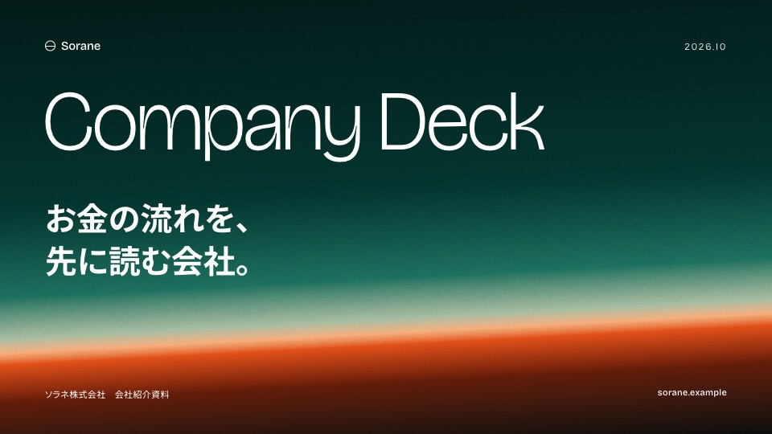
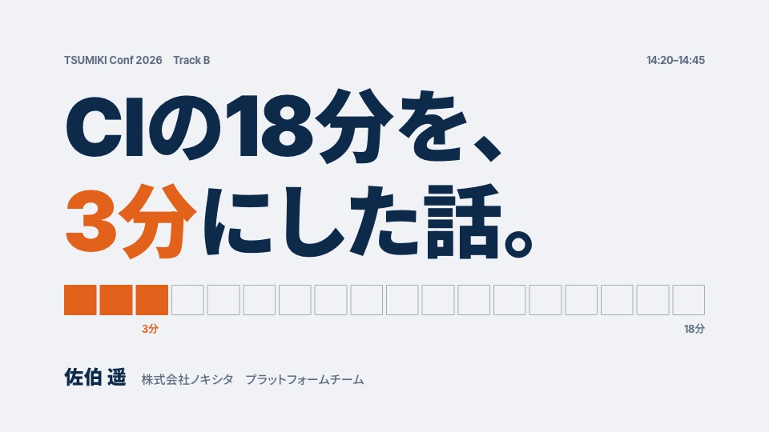
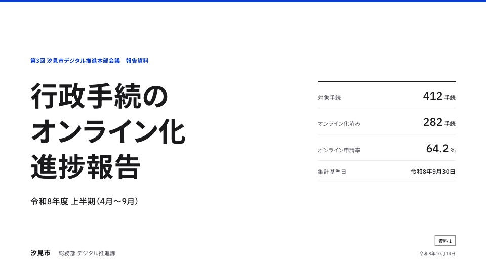
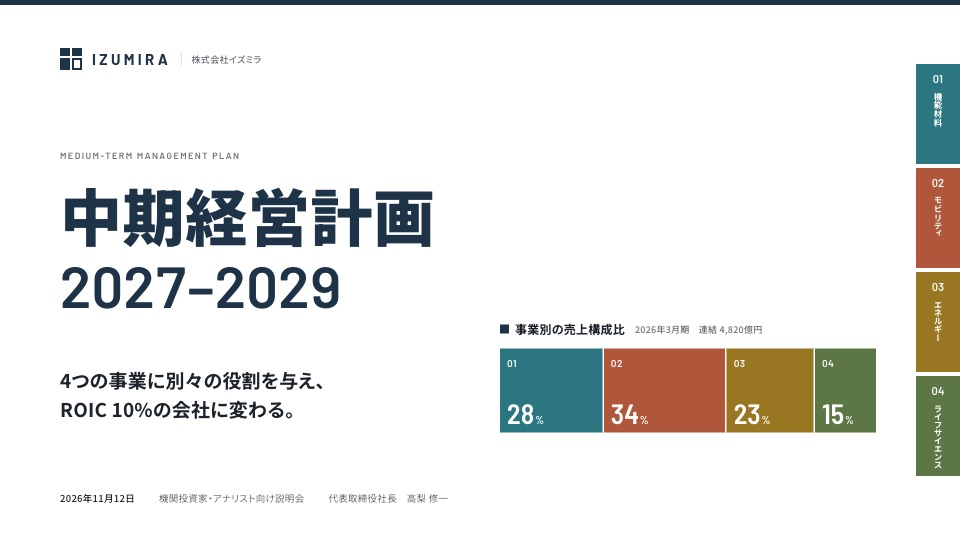

# Frontend Slides（日本語版）

日本語のプレゼン資料を、1枚の HTML ファイルとして作る AI エージェント用のスキルです。日本で評価の高い会社紹介・採用ピッチ・決算資料・統合報告書を調べて作った 11 のスタイルから選べます。自社のデザインシステムを渡して、その見た目で作ることもできます。

[zarazhangrui/frontend-slides](https://github.com/zarazhangrui/frontend-slides) のフォークです。元のスキルの考え方（AI が作りがちな凡庸なデザインを避ける、選ぶ前に見せる、1920×1080 の固定ステージ）はそのまま引き継いでいます。

## できること

- **新しく作る。** 目的・枚数・内容・密度を聞いたうえで、スタイルの試作を 3 枚見せ、選んだスタイルでデッキ全体を作ります。
- **PowerPoint を変換する。** `.pptx` から文章・画像・ノートを取り出し、選んだスタイルで作り直します。
- **既存の HTML を直す。** はみ出しや重なりを確かめながら、内容を足したり分けたりします。
- **共有する。** Vercel で URL を発行するか、PDF に書き出します。

## スタイル

| | スタイル | 向く場面 |
| --- | --- | --- |
|  | **コーポレート単色** `corporate-mono` | 会社紹介、採用ピッチ、サービス資料 |
|  | **グラデーション扉** `gate-gradient` | テック企業の会社紹介、カンファレンス |
|  | **青白と幾何モチーフ** `geometric-blue` | 研究開発、技術説明、エンジニア採用 |
|  | **1枚1メッセージの登壇** `talk-one-message` | 勉強会、技術カンファレンス、LT |
|  | **公共・標準** `public-standard` | 行政・自治体、公式報告、仕様説明 |
|  | **ブランド温色** `warm-editorial` | BtoC、食品、ブランドブック |
|  | **写真主導エディトリアル** `photo-editorial` | 思想、統合報告、ブランドブック（写真が必要） |
|  | **縦組みエディトリアル** `tategumi-editorial` | 老舗、文化財団、長期構想、周年 |
|  | **ダーク・キーノート** `dark-keynote` | 製品発表、配信イベント |
|  | **スイス・タイポグリッド** `swiss-grid` | デザイン・建築・文化イベント |
|  | **章色インデックス** `color-index` | 中期経営計画、複数事業の会社案内 |

全スタイルは `plugins/frontend-slides/skills/frontend-slides/styles/gallery.html` で一覧できます。用途ごとに並び、明暗・格式・写真の要否で絞り込めます。各スタイルの `reference.html` をブラウザで開くと、4 枚の見本を矢印キーで送れます。

## 日本語のための工夫

- **フォントは実測した台帳から選びます。** Google Fonts の和文書体の多くは、約物と仮名を詰める `palt` が効きません。`fonts/catalog.json` は書体ごとに `palt`（横組み）と `vpal`（縦組み）が効くかを実測して記録し、見出しには詰まる書体だけを使います。測り直しは `scripts/measure-fonts.mjs` で行います。
- **禁則と改行。** `line-break: strict` と文節単位の改行（`word-break: auto-phrase`）を全デッキに入れ、見出しは文節の切れ目で手で改行します。
- **数値で決めたデザイン規則。** 色は 1 枚に 4 色まで、強調は 3 種類まで、見出しは結論を書く、KPI の数字は単位の 3〜4 倍、など。参考にした実例から取った規則です。
- **縦組み。** 縦書きの見出しと横組みの図表を同じスライドに置けます。

## インストール

### Claude Code（プラグイン）

次の 2 つを、別々のメッセージとして実行してください。

```text
/plugin marketplace add https://github.com/masafumimori/frontend-slides
```

```text
/plugin install frontend-slides@frontend-slides
```

使うときは `/frontend-slides:frontend-slides` と入力します。

### Claude Code（手動）

```bash
git clone https://github.com/masafumimori/frontend-slides.git /tmp/frontend-slides && cp -R /tmp/frontend-slides/plugins/frontend-slides/skills/frontend-slides ~/.claude/skills/
```

使うときは `/frontend-slides` と入力します。

### ほかのエージェント

Codex などには、このリポジトリの URL を渡して「Frontend Slides スキルを使って」と頼んでください。エージェントは `plugins/frontend-slides/skills/frontend-slides/SKILL.md` から読み始め、必要なファイルだけを読みます。

## 使い方

```text
/frontend-slides:frontend-slides

> 来月の採用説明会で使う会社紹介資料を作りたい
```

自社のデザインシステムを使うときは、ロゴ・ブランドガイドの PDF・サイトの URL などを一緒に渡してください。スキルがそれを `~/.frontend-slides/brands/<名前>/` にスタイルとして保存し、次からも使えるようにします。リポジトリの中には保存しません。

## 共有

```bash
bash plugins/frontend-slides/skills/frontend-slides/scripts/deploy.sh ./my-deck.html
```

```bash
bash plugins/frontend-slides/skills/frontend-slides/scripts/export-pdf.sh ./my-deck.html
```

URL の発行には Vercel のアカウント、PDF の書き出しには Node.js が必要です（Playwright は自動で入ります）。

## スタイルを足す・直す

形式は `styles/README.md` にあります。足したり直したりしたあとは、次を実行してください。全スタイルを検査し、`styles/selection-index.json` を作り直します。

```bash
node plugins/frontend-slides/skills/frontend-slides/scripts/check-styles.mjs
```

サムネイルの撮影（`scripts/shoot.mjs`）と一覧ページの再生成（`scripts/build-gallery.mjs`）の手順も `styles/README.md` にあります。

スタイルを作るときに調べた参考事例の分析は `docs/research/` にあります。

## クレジット

元のスキルは [@zarazhangrui](https://github.com/zarazhangrui) による [frontend-slides](https://github.com/zarazhangrui/frontend-slides) です。

## ライセンス

MIT
